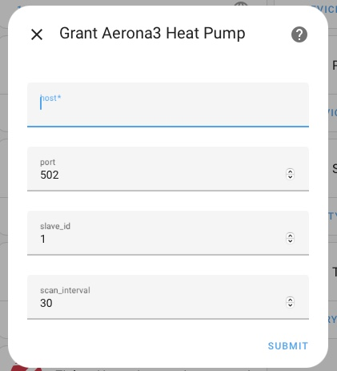
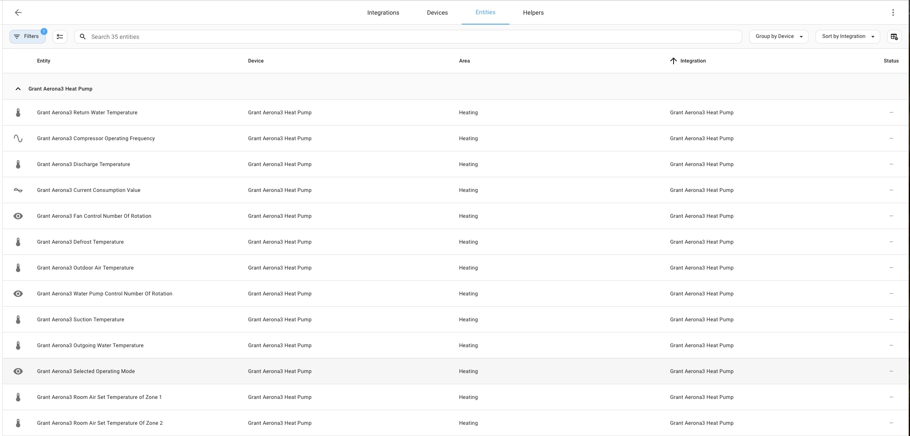
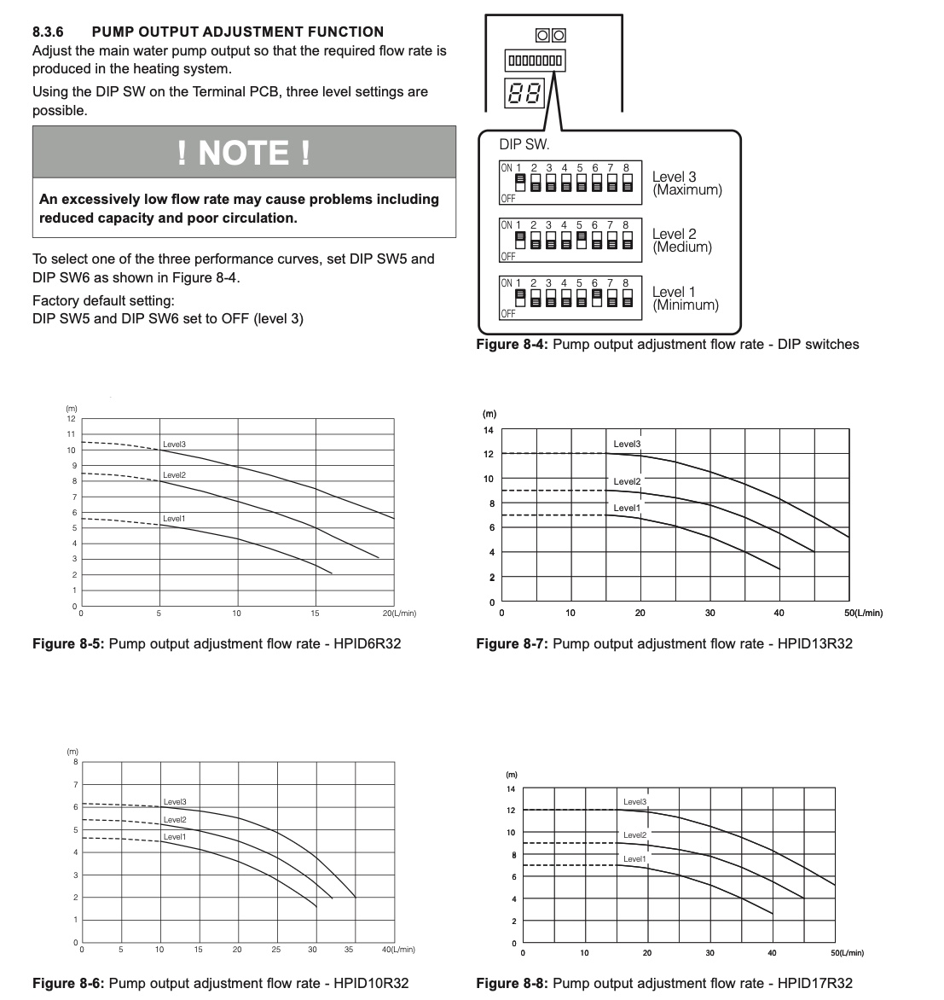
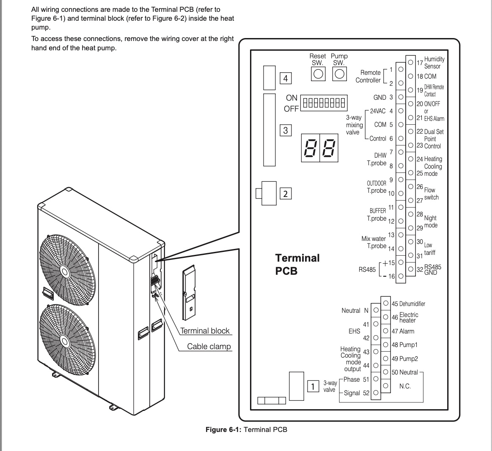

# Unofficial Grant Aerona3 Heat Pump Integration for Home Assistant

[](https://www.home-assistant.io/)
[](https://hacs.xyz/)
[](#)

An unofficial Home Assistant integration for **Grant Aerona3 air-source heat pumps**, communicating over Modbus (TCP or serial/RS485). It is not affiliated with or endorsed by Grant Engineering.

The integration reads and writes the heat pump's Modbus registers directly and exposes them as Home Assistant entities: sensors for live readings, numbers for setpoints and timers, switches for on/off features, and binary sensors for status flags.

## Features

- Works over Modbus TCP (e.g. via an RS485-to-Ethernet converter) or a local serial/RS485 connection
- Hardware feature toggles so you only get entities for the parts of the system you actually have (see below) — an install with everything ticked creates 150+ entities, most systems need far fewer
- Setpoint and timer control via number entities (DHW temperatures, weather-compensation curves, delays, hysteresis, etc.)
- Calculated COP and delta-T sensors based on a flow rate you configure
- Energy usage tracking and cost estimation sensors
- Options flow for changing scan interval, flow rate, and hardware toggles after setup, without removing the integration

## Hardware feature toggles

During setup (and later via **Settings → Devices & Services → Grant Aerona3 → Configure**) you tick which parts of your system are actually fitted. Unticked features are hidden from the UI and their Modbus registers are not polled, which also reduces the number of Modbus transactions per scan cycle.

| Toggle | What it covers |
|---|---|
| Hot water (DHW) cylinder | Domestic hot water cylinder heated by the heat pump |
| Buffer tank / volumiser | Buffer tank with temperature probe (terminals 11-12) |
| External heat source (EHS) | Hybrid boiler / external heat source for space heating (terminals 41-42) |
| Cooling mode | System configured to provide cooling as well as heating |
| Heating zones | Single zone, or dual zone with a second (slave) circuit |
| Backup / immersion heater | Electric backup heater fitted alongside the heat pump |
| Humidity sensor | Room humidity sensor wired to terminals 17-18 |
| Mixing valve / secondary circuit | 3-way mixing valve or low-loss header on terminals 4-5-6 and 13-14 |
| Additional outdoor sensor | Second outdoor temperature probe wired to terminals 9-10 |
| Low tariff / night mode signal | Wired to an economy-tariff or night-time noise-limiting signal (terminals 28-31) |
| Dehumidifier | Dehumidifier wired to terminal 45 |
| Advanced / installer settings | Frost-protection tuning, pump timing, error history, and terminal wiring switches — set once, rarely touched again |

Existing installs keep every entity after upgrading; the options above only change what a *new* install creates by default, and can be adjusted later from Configure either way.

## Quick Start

1. **Install** the integration (see the [Installation Guide](Docs/installation_guide.md))
2. **Add the integration** via Home Assistant: Settings → Devices & Services → Add Integration → Grant Aerona3 Heat Pump
3. **Choose connection type** and enter the details (IP address and port for Modbus TCP, or the serial device path for RS485)
4. **Tick the hardware toggles** that match your system
5. **Set your flow rate** for accurate COP calculation (see the [Flow Rate Guide](Docs/flow_rate_guide.md))
6. Entities for your selected hardware are created and start updating on the configured scan interval

## What you get

Exact entity counts depend on which hardware toggles are enabled. With everything ticked, the integration currently exposes:

- **Sensors** — temperatures (flow, return, outdoor, DHW tank, discharge, suction, defrost), power consumption, calculated COP and delta-T, compressor frequency, pump speed, operating mode, and energy usage/cost estimates
- **Binary sensors** — compressor running, defrost active, heating/DHW active, alarm status, backup heater status, frost protection, communication status, weather-compensation status
- **Switches** — weather compensation per zone, frost protection, anti-legionella, humidity compensation, night mode, terminal wiring options (gated by the toggles above)
- **Numbers** — every writable setpoint and timer on the heat pump (temperature setpoints, weather-compensation curves, delays, hysteresis, flow rate)

Note: the coordinator only polls a small, fixed subset of the coil registers on every refresh (to avoid Modbus timeouts), so a handful of the coil-backed switches show their last-known state rather than a live one between full refreshes.

## Documentation

| Document | Description |
|----------|-------------|
| [Installation Guide](Docs/installation_guide.md) | Step-by-step installation instructions |
| [Configuration Guide](Docs/configuration_guide.md) | Detailed configuration options |
| [Flow Rate Measurement](Docs/flow_rate_guide.md) | How to measure and configure flow rate for accurate COP |
| [Troubleshooting](Docs/troubleshooting_guide.md) | Common issues and solutions |
| [Register Reference](Docs/reference_files/) | Full list of supported registers |
| [Examples](Examples/) | Sample automations and dashboard cards |

## Requirements

- Home Assistant 2025.9.0 or newer
- Grant Aerona3 heat pump with a Modbus TCP or RS485 interface
- A network connection (Modbus TCP) or a serial/USB-RS485 connection between Home Assistant and the heat pump
- `pymodbus>=3.7.0,<4.0.0` and `pyserial>=3.4` (installed automatically)

## Screenshots

### Integration Setup


### Hardware Configuration


### Flow Rate Configuration


### PCB Diagram


## Hardware Setup (Modbus TCP)

If connecting over Modbus TCP via an RS485-to-Ethernet converter:

**Recommended:**
- [Waveshare RS232/485/422 to PoE ETH-B](https://www.waveshare.com/rs232-485-422-to-poe-eth-b.htm) — Power over Ethernet, industrial-grade

**Alternative:**
- [RS232 to RJ45 Ethernet Module](https://thepihut.com/products/rs232-to-rj45-ethernet-module) — basic functionality for budget setups

### Enclosure
- [Waterproof Enclosure](https://www.amazon.co.uk/Enclosure-Consumer-Waterproof-Terminals-Connectors/dp/B0BGSC2FF2) for outdoor-mounted converters

## Recommended HACS Dashboard Components

Not required, but useful for building dashboards with this integration:
```
lovelace-card-mod
apexcharts-card
mushroom
card-mod
energy-flow-card-plus
button-card
```

## Support & Contributing

- **Report Issues**: [GitHub Issues](https://github.com/Si-GCG/Unofficial-Grant-Aerona3-Home-Assistant-Integration/issues)
- **Feature Requests**: [GitHub Discussions](https://github.com/Si-GCG/Unofficial-Grant-Aerona3-Home-Assistant-Integration/discussions)
- **Documentation**: [Docs/](Docs/) folder
- Pull requests welcome — this is a solo-maintained project with no CI, so please run the checks in `.claude/skills/validate` (or the equivalent manual steps) before submitting

## Changelog

### v1.2.0
- **Breaking change**: removed the duplicate read-only `sensor.*` entity for every writable holding register (setpoints) — only the `number.*` entity remains, since it already showed the same value. If a dashboard, automation, or template referenced one of these sensors, point it at the matching `number.*` entity instead (see the [troubleshooting guide](Docs/troubleshooting_guide.md#dashboard-card-shows-entity-not-available-after-updating))
- Added 7 new optional-hardware toggles: backup/immersion heater, humidity sensor, mixing valve/secondary circuit, additional outdoor sensor, low-tariff/night-mode signal, dehumidifier, and a bundled "advanced/installer" group (frost-protection tuning, pump timing, error history, terminal wiring switches). Each hides the matching entities and stops polling those registers
- Existing installs keep every entity on upgrade; new installs default the optional toggles off

### v1.1.4
- Breaking change: removed the climate platform and its entities
- Simplified configuration by removing unused zone/DHW options
- Updated documentation and examples

### v1.1.2
- Home Assistant 2025.9.0b5 compatibility
- Entity naming improvements
- Enhanced options flow and error handling
- Added weather compensation and energy monitoring sensors

### v1.0.0
- Initial release

## License

This project is licensed under the MIT License — see the [LICENSE](LICENSE) file for details.

## Acknowledgments

- Grant Engineering for the Aerona3 heat pump series
- The Home Assistant community
- Contributors and testers who helped improve this integration

## Useful Links

- [Renewable Heating Hub Forums](https://renewableheatinghub.co.uk/forums)
- [Open Energy Monitor](https://openenergymonitor.org)
- [Home Assistant Green](https://www.home-assistant.io/green/)

---

## Installation Methods

### Method 1: HACS (Recommended)
1. Open HACS in Home Assistant
2. Go to "Integrations"
3. Click the three-dot menu → "Custom repositories"
4. Add this repository's URL
5. Install "Grant Aerona3 Heat Pump"
6. Restart Home Assistant

### Method 2: Manual Installation
1. Download the latest release
2. Copy `custom_components/grant_aerona3/` into your Home Assistant `custom_components/` directory
3. Restart Home Assistant
4. Add the integration via Settings → Devices & Services
